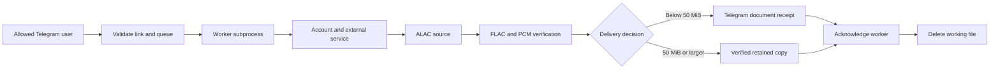
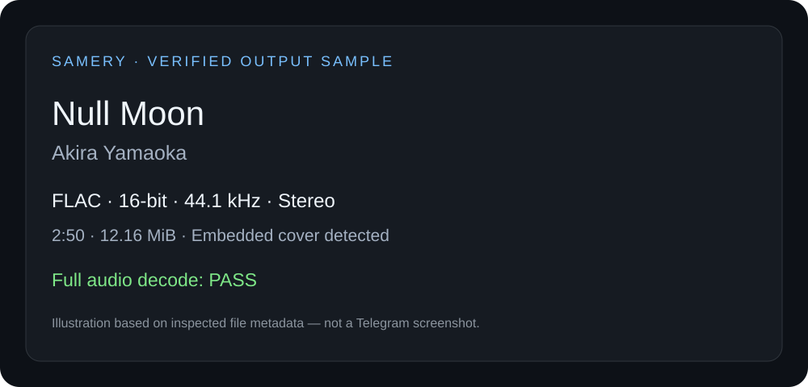

# Samery · Apple Music Telegram Bot

[](https://github.com/omidalighadr/samery-flac-showcase/actions/workflows/toolkit.yml)

**Apple Music links → FLAC, artwork and track metadata in Telegram.**

A focused Python project by **Omid Alighadr**: a Telegram front end around an extracted download integration, with audio verification, Docker packaging and automated tests.

[Setup](docs/SETUP.md) · [Architecture](docs/ARCHITECTURE.md) · [Bot source](apple_music/bot.py) · [Measured sample](validation/sample-report.json) · [Security](SECURITY.md)

## Run the offline demo

With Python 3.12 and FFmpeg/FFprobe installed:

```sh
python -m pip install -r apple_music/requirements-test.txt
python apple_music/demo.py
```

The demo generates a tone, converts ALAC to FLAC with PCM verification, then runs the bot's job loop with a simulated Telegram receipt. It prints the receipt and confirms job cleanup. It needs no accounts and makes no network calls during execution. CI also runs it in Docker with networking disabled.

## Engineering highlights

- **Lossless conversion:** requests the best available ALAC source, preserves bit depth, sample rate and channels, and compares decoded PCM hashes after conversion to FLAC.
- **Delivery coordination:** checks the Telegram attachment size before acknowledging a track to the worker. Unconfirmed outputs remain on disk.
- **Controlled concurrency:** allowlisted users, one active worker, a bounded in-memory queue and cancellation.
- **Complete track presentation:** embedded artwork, thumbnail, clean filename and track metadata.
- **Deployment checks:** isolated audio/protocol tests, Python compatibility checks and Docker build/import checks in CI.

## Download pipeline



[Component boundaries, failure handling and retention rules →](docs/ARCHITECTURE.md)

## Run your own instance

Requirements: your own Telegram bot token, allowed user IDs, active Apple Music account, private cookie file and compatible external Wrapper service.

```sh
cp .env.example .env
# Configure your own account and external service; see docs/SETUP.md.
docker compose up --build -d
```

**Deployment status:** the public image has build/import checks. A clean-install account-to-Telegram download has not been validated; the private deployment uses an additional patched dependency wheel that is not distributed here. See [setup and deployment limits](docs/SETUP.md).

## Output evidence



This is an **illustration**, not a Telegram screenshot. It represents an inspected **Null Moon — Akira Yamaoka** file: FLAC, 16-bit / 44.1 kHz, stereo, **170.307 seconds**, with embedded artwork. That saved file passed a strict full decode on **1 November 2026**. [Measurement report →](validation/sample-report.json)

## Source and tests

| Location | Responsibility |
| --- | --- |
| [`apple_music/bot.py`](apple_music/bot.py) | Authorization, queue, subprocess coordination and delivery |
| [`apple_music/scripts/`](apple_music/scripts/) | Account integration, local protocol adapter, audio conversion and metadata |
| [`apple_music/tests/`](apple_music/tests/) | Synthetic audio tests and isolated bot/protocol fixtures |
| [`toolkit/`](toolkit/) | Standalone audio comparison and file-sending utilities |
| [`tests/test_private_files.py`](tests/test_private_files.py) | Ignore-rule regression tests and tracked private-file checks |

The integration modules were extracted from the private Samery application. The standalone public front end is separate from the full personal assistant. Tests use generated audio, mocked services or loopback fixtures; CI does not log in to an account or establish live service availability.

Queue state is in memory. Files at or above 50 MiB remain on the host; unconfirmed uploads are not automatically replayed. [Full operating limits →](docs/SETUP.md#deployment-limits)

## Credits and use

Built around [GAMDL](https://github.com/glomatico/gamdl), FFmpeg and python-telegram-bot; see [integration attribution](apple_music/README.md#dependencies-and-attribution). Use only accounts and media you are authorized to use.

No additional reuse license has been selected. See [GitHub's licensing guidance](https://docs.github.com/en/repositories/managing-your-repositorys-settings-and-features/customizing-your-repository/licensing-a-repository).
