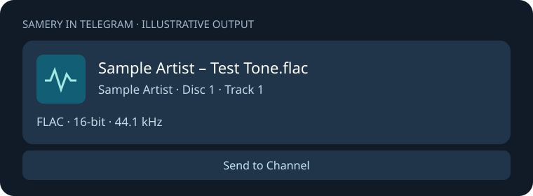

# Samery · Apple Music to FLAC

Samery is a Telegram bot that delivers Apple Music tracks as FLAC with artwork and track metadata. This repository contains the standalone FLAC command-line tool and its offline verification demo. The main Telegram bot runs as a private deployment.

## Features

- **Public CLI:** accepts track, album and playlist links and saves FLAC files locally.
- **Audio verification:** checks source bit depth, sample rate and channels, then compares decoded PCM after conversion.
- **Private Telegram bot:** delivers tracks with cover art, metadata and a Send to Channel button. Files above the configured upload limit are kept on the Mac for manual delivery.

## Samery in Telegram



Illustrative output with synthetic data.

## Quick start

Install Python 3.12, FFmpeg and FFprobe. Then run the offline demo from the repository root.

```sh
python3.12 -m venv .venv
. .venv/bin/activate
python -m pip install 'mutagen>=1.47,<2'
python apple_music/demo.py
```

The demo generates an ALAC tone, converts it to FLAC and compares the decoded PCM. It runs locally with generated audio.

```text
Verified tone.flac: 16-bit, 44100 Hz. PCM matches.
```

## Live downloads

Follow the [setup guide](docs/SETUP.md) for macOS and Linux, the [sample environment settings](.env.example), and examples for tracks, albums and playlists. See [troubleshooting](docs/SETUP.md#troubleshooting) for setup and partial-download errors.

## Validation

- [GitHub Actions](https://github.com/omidalighadr/samery-flac-showcase/actions/workflows/flac.yml) runs the offline PCM demo and CLI tests with a simulated worker.
- A previous macOS live smoke test saved one 24-bit / 44.1 kHz track using a separately configured legacy service and verified a full FLAC decode. Service installation, live v2 and Telegram delivery are outside the public test suite.

Built using [GAMDL](https://github.com/glomatico/gamdl) and FFmpeg. Upstream components retain their licenses. Use your own account and media you are authorized to use.
