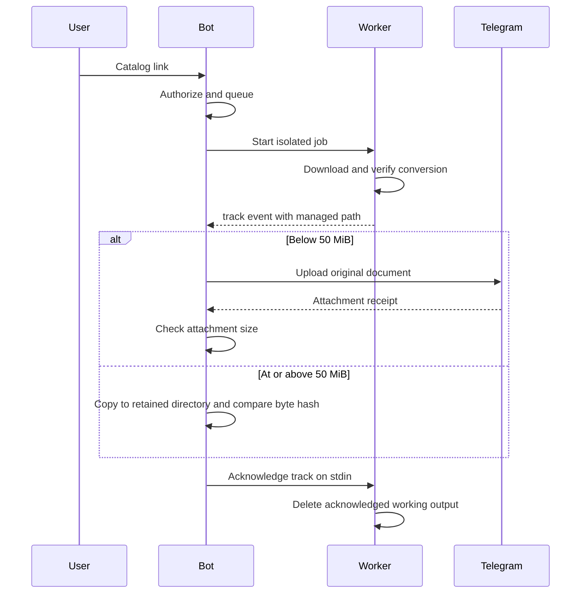

# Architecture

[Project overview](../README.md) · [Setup](SETUP.md)

## Components and trust boundaries

The public bot is an orchestration layer. It validates a single catalog URL, checks the user's numeric ID and submits work to a bounded queue. One subprocess performs media work; the main Telegram update loop owns user interaction and delivery.

| Component | Boundary |
| --- | --- |
| `apple_music/bot.py` | Reads environment configuration, authorizes users, owns jobs and receives worker events |
| `scripts/apple_worker.py` | Uses the account and external service, downloads, converts and emits JSON-line events |
| `scripts/apple_legacy.py` | Adapts a loopback-only service protocol; does not provide the external daemon |
| `scripts/apple_audio.py` | Checks ALAC input, converts without resampling and compares decoded PCM hashes |
| `scripts/music_metadata.py` | Artwork, lyrics, filenames and captions |
| `data/jobs/` | Isolated job outputs and unconfirmed files |
| `data/retained/` | Verified retained copies of large files |

Credentials stay in environment configuration or a privately mounted cookie file. The Docker build uses an explicit source allowlist. The external service must be deployed and authenticated separately; it is outside this repository's test boundary.

## Delivery acknowledgement

If delivery cannot be confirmed, the parent does not acknowledge that file. The worker's EOF/cancellation path retains the unconfirmed output. Successful conversion proves equality with the supplied ALAC source, not the provenance or original mastering of the recording.

## Failure behavior

- Invalid user IDs, unsupported links and incomplete configuration are rejected before a job starts.
- Queue size and per-user activity are bounded; queue state does not survive restart.
- A cancelled subprocess is terminated as a process group to include its download children.
- Large-file retention is verified before acknowledgement.
- An uncertain Telegram response is not automatically retried because the upload may already have arrived.
- Third-party worker diagnostics are suppressed; the JSON event protocol communicates fixed event types. This snapshot does not provide a persistent event store, metrics endpoint or distributed tracing.

## Validation boundary

Audio tests use synthetic signals. Bot and HTTP tests use mocks; protocol checks use loopback fixtures. Docker CI builds and imports dependencies without accounts. Live authentication, external-service readiness and clean-install end-to-end operation remain separate deployment checks.
